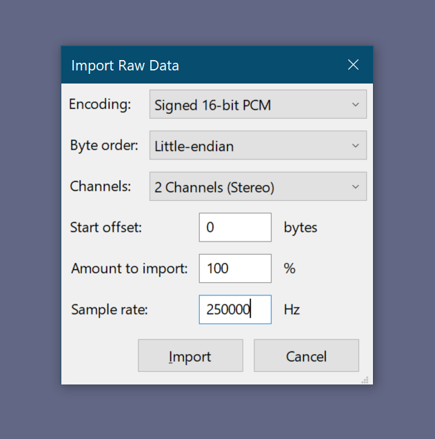
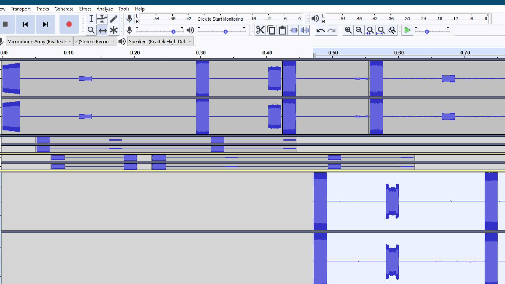
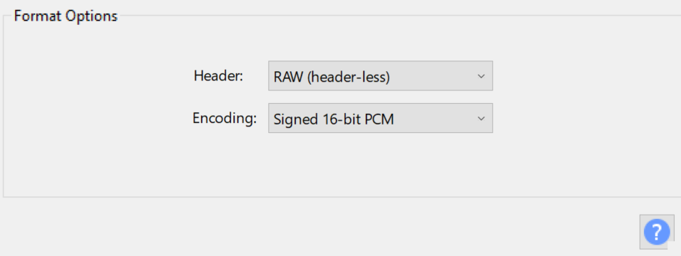
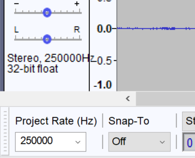

The [[Capture]] app records into C16 files, and the Replay app read those files. *(Support for C8 format has since been added to firmware, but this chapter assumes that files were captured in C16 format; most instructions below apply to C8 files as well by just replacing the 16 with 8.)*

As described in an [issue](https://github.com/sharebrained/portapack-hackrf/issues/139) in PortaPack's repo, this format consist of a tuple of 16 bits signed integers. The first number is I and second Q, forming a complex number. As a result, you get a tridimensional representation of the capture: the real and the imaginary parts in the file (I and Q) versus the time (defined by the sample rate, in this case in an adjacent TXT file with the same filename as the C16).

## Metadata file (.TXT)

Each capture file is accompanied by a `.TXT` file with the same name. The file contains at minimum:
```
center_frequency=<FREQ IN HZ>
sample_rate=<RATE IN HZ>
```

If a GPS module was connected and provided a valid fix during capture, three additional fields are written:
```
latitude=<DECIMAL DEGREES>
longitude=<DECIMAL DEGREES>
satinuse=<SATELLITES IN USE>
```

These fields are optional — the Replay app reads them but does not require them.

### Capture Manipulation (Audacity)

You can open the C16 file in Audacity importing it as *Raw data*. Consider the sample rate you used when you did the capture.



It is possible to manipulate the data as if it was audio. When importing the file as signed 16 bit PCM with two channels, the upper channel contains the I and the second Q, as explained above. You can apply filters, add silences, trim, mix and merge.



To export the data as a C16 file, select Export, Export Audio ... and then select RAW as a 16 bit signed PCM. After saving, change the extension and you will be able to use the file in the Replay app.



For using the new C16 file in the Replay app, you will also need to include a TXT file with the metadata as described above.

As a final remark, if you created a new file, be sure that the Project Rate matches your capture:



### Capture Manipulation (GNU Radio)

You can use GNU Radio Companion (GRC) to convert the C16 short into a complex IQ file.


As seen in the image above you'll need to bring in the original C16 file using the GRC block `File Source` setting the output type to short, pipe it to `IShort To Complex`, then `Multiply Constant` using the magic number 1.0 / 32768.0 for the constant, and finally export it with `File Sink`.

The reason that the value 32768.0 is used to normalize the C16 capture is because int16 has a range of -32768 to +32767. 2^15 is 32768.0, so dividing int16 value by 2^15 gives a number that is normalized between -1 and +1.

This GRC script can be found at [`firmware/tools/convert_C16_to_complex.grc`](https://github.com/portapack-mayhem/mayhem-firmware/blob/next/firmware/tools/convert_C16_to_complex.grc)
