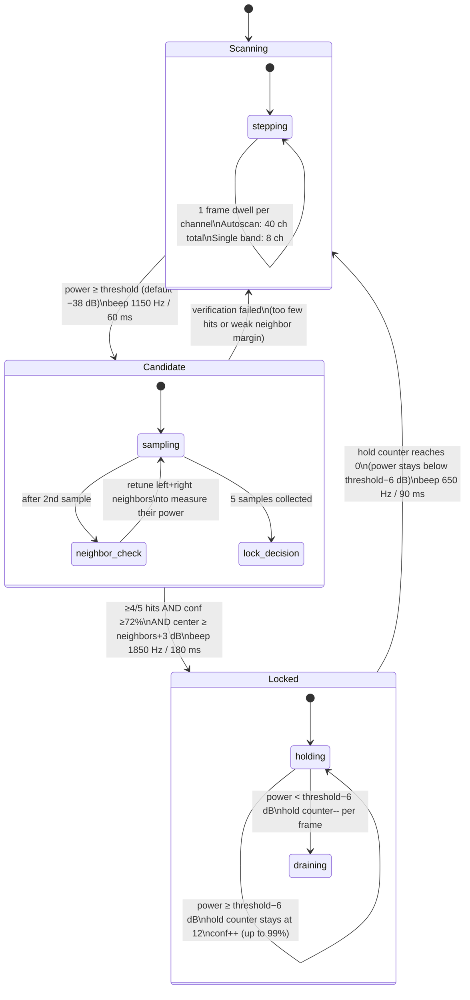

# Introduction

**FPV Detect** is a PortaPack application for detecting analog FPV (first-person view) video signals and identifying their channel across the 5.8 GHz band. It covers all standard FPV bands — A, B, E, F, and R — used by most analog drone video transmitters (VTX) and goggles. The app can scan a single selected band or run **AutoScan** across all 40 channels simultaneously.

Its use is not limited to drone racing — it can be used to locate any analog FPV carrier in the 5.6–5.9 GHz range.

This is an [external app](External-apps-informations) (`.ppma` file on the SD card).

# Controls

**Top row:**

* **LNA:** Low Noise Amplifier gain (0–40 dB).
* **VGA:** Variable Gain Amplifier / baseband gain (0–62 dB).
* **AMP:** RF preamplifier — 0 = off, 1 = on (+14 dB). Use with caution near strong signals.
* **VOL:** Audio output volume.

**Second row:**

* **Band selector:** Choose which band to scan — `Band A`, `Band B`, `Band E`, `Band F`, `Band R`, or `AutoScan` (default). AutoScan steps through all 5 bands × 8 channels = 40 channels in order.
* **Frequency display:** Shows the current channel being monitored in the format `B3  5771 MHz` (band letter, channel number, frequency).

**Third row:**

* **State badge:** Current detection state — `SCANNING`, `VERIFY FPV`, or `DRONE FOUND` (red when locked).
* **Conf X%:** Detection confidence percentage (0–99%). Increases during verification and lock.
* **Thr> / threshold field:** Detection threshold in dBm, adjustable from −100 to +20. Default: **−38 dB**. Only signals above this level trigger detection. Increase to reduce false positives in noisy environments; decrease if signals are weak.

**Fourth row:**

* **RSSI min/avg/max:** Scrolling RSSI bar graph (256 columns) showing min, average, and maximum received levels.
* **PWR X dB:** Current peak channel power in dB.

**Status lines:**

* **Status text:** Human-readable summary — band/channel/frequency when verifying or locked.
* **Detail text:** During scanning: shows the threshold requirement. During verification: shows average dB, peak dB, hit/sample counts. During lock: shows locked channel, confidence, and hold counter.

The lower part of the screen shows the scrolling RSSI history graph and a vertical peak-hold RSSI indicator on the right.

# Detection algorithm

The app uses a three-state machine. The key insight is that a real FPV carrier is a **narrow peak** — it stands out clearly from adjacent channels. Broadband interference (Wi-Fi, noise) does not, so it gets filtered out during the neighbor check in the Candidate state.

**Scanning** — the receiver steps through channels one by one, dwelling for 1 frame per channel. When power exceeds the detection threshold, it enters Candidate.

**Candidate** — the app stays on the suspected channel and collects up to 5 power samples. After the 2nd sample it briefly re-tunes to the adjacent channels (left neighbor, then right neighbor) to measure their current power. A confidence score is computed from: average power above threshold, peak margin, hit/miss ratio, and neighbor margin (center power minus the strongest adjacent channel). Lock requires all three: ≥4 hits out of 5 samples, confidence ≥72%, and center channel at least 3 dB above neighbors. A fast-lock path fires earlier if peak exceeds threshold by ≥8 dB and confidence ≥80%.

**Locked** — the app stays on the confirmed channel, shows `DRONE FOUND` in red, and emits a long beep. A hold counter (max 12) prevents brief signal fades from unlocking immediately — each frame below the unlock threshold (= detection threshold − 6 dB) decrements the counter; unlock only occurs when it reaches zero.

# FPV channel frequencies

All 40 standard channels covered by the app:

| Ch | Band A (MHz) | Band B (MHz) | Band E (MHz) | Band F (MHz) | Band R (MHz) |
|----|-------------|-------------|-------------|-------------|-------------|
| 1  | 5865        | 5733        | 5705        | 5740        | 5658        |
| 2  | 5845        | 5752        | 5685        | 5760        | 5695        |
| 3  | 5825        | 5771        | 5665        | 5780        | 5732        |
| 4  | 5805        | 5790        | 5645        | 5800        | 5769        |
| 5  | 5785        | 5809        | 5885        | 5820        | 5806        |
| 6  | 5765        | 5828        | 5905        | 5840        | 5843        |
| 7  | 5745        | 5847        | 5925        | 5860        | 5880        |
| 8  | 5725        | 5866        | 5945        | 5880        | 5917        |

The receive bandwidth is 750 kHz per channel (IQ capture mode, no audio demodulation during scanning).

> **Note:** Band E channels 5–8 (5885–5945 MHz) and Band R channel 8 (5917 MHz) fall outside the standard 5.725–5.875 GHz ISM band. These are legal to receive but may not be legal to transmit on in all regions.

# ⚠️ False positives

FPV Detect can trigger false positives, particularly **indoors or in urban environments** where the 5.8 GHz band is crowded with non-FPV sources. Detection is based on signal power, not video content analysis — any sufficiently strong narrow emission near an FPV channel frequency can cause a lock. Common interference sources include Wi-Fi 5/6 routers (5.725–5.825 GHz overlap), ISM band devices (wireless cameras, baby monitors), wireless HDMI senders, and harmonic emissions from other transmitters.

If false locks occur frequently: raise the detection threshold, select a specific band instead of AutoScan, or move to an area with less RF congestion. When locked, the audio output lets you verify: an actual FPV analog video carrier produces a characteristic buzz, while interference typically sounds like noise or silence.

# Settings persistence

The detection threshold value is saved automatically and restored on next launch. Settings are stored in `SETTINGS/rx_fpv.ini` on the SD card.e.